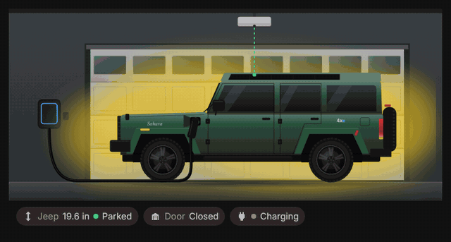
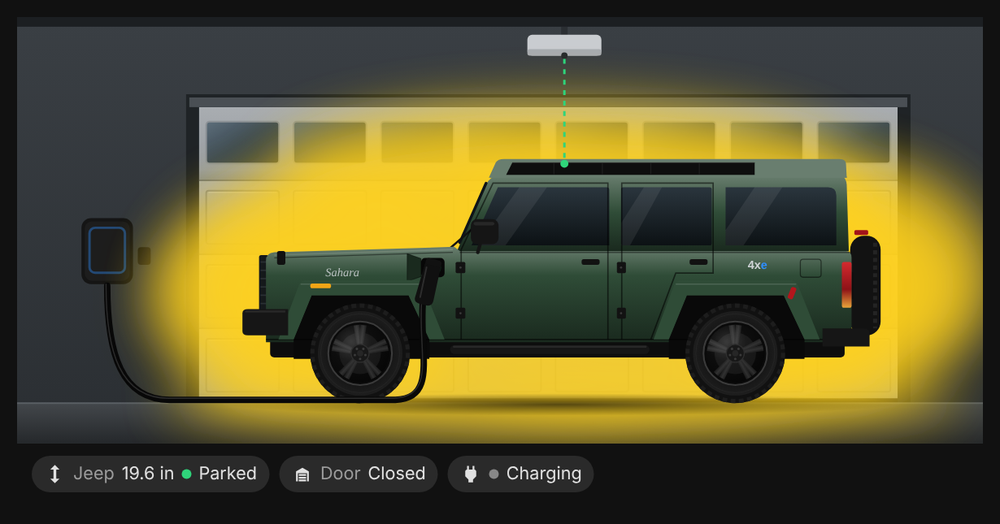
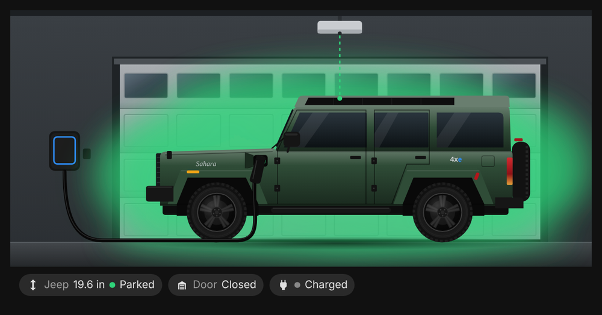
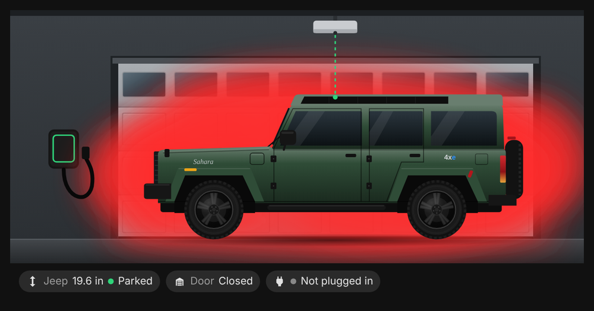
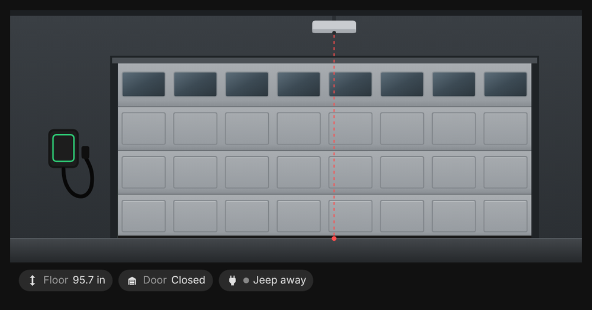
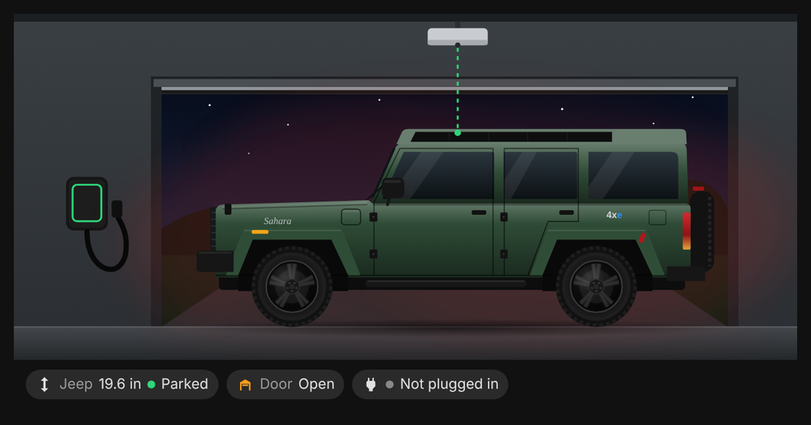
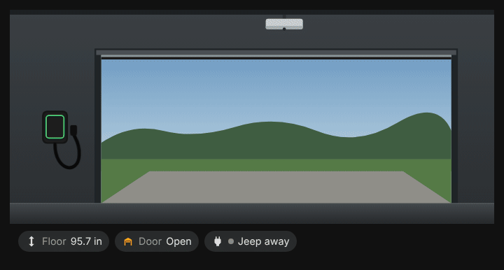
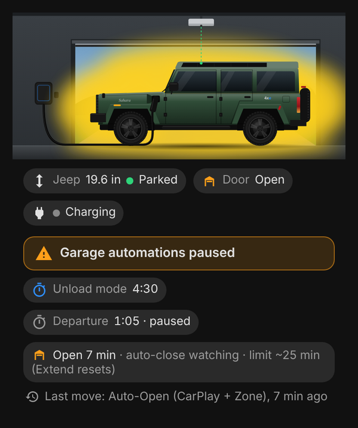
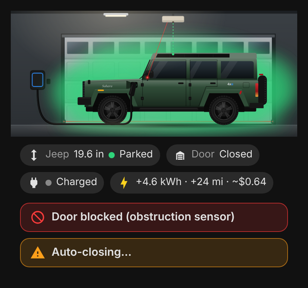
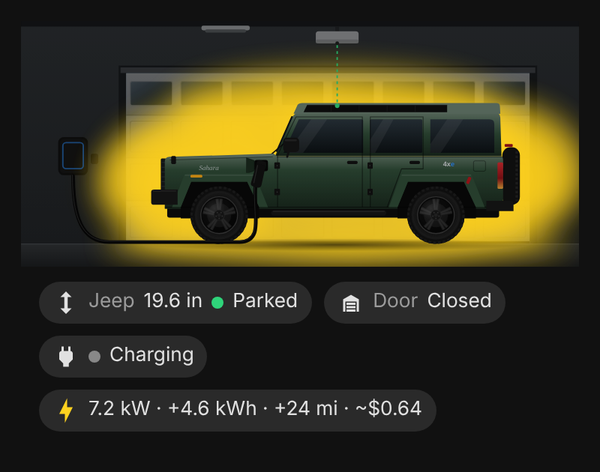

<h1 align="center">🚙 Jeep 4xe Garage Card</h1>

<p align="center">
  A Home Assistant dashboard card that shows a hand-drawn <b>Hunter Green Jeep Wrangler Unlimited 4xe Sahara</b> in your garage:<br>
  plugged in or not, charging or done, how far it is from the opener, and what the garage door and its automations are doing.
</p>

<p align="center">
  <a href="https://hacs.xyz"></a>
  <a href="https://github.com/2tk785fryr-tech/4xe-Jeep/releases/latest"></a>
  
</p>

<p align="center">
  
</p>

<p align="center">
  <a href="#-install">Install</a> ·
  <a href="#-set-up">Set up</a> ·
  <a href="#-what-it-shows">What it shows</a> ·
  <a href="#-garage-automation-status">Automation status</a> ·
  <a href="#-garage-extras">Garage extras</a> ·
  <a href="#%EF%B8%8F-all-options">All options</a>
</p>

---

## ✨ Highlights

- 🎨 **A detailed drawing of the Jeep:** green hardtop with the black power roof, black wheels, trapezoid fender flares, Sahara and 4xe badges, and a charge port that opens when it's plugged in.
- ⚡ **Charging at a glance:** a glowing haze behind the Jeep. Yellow and flashing while charging, calm green when done, red and pulsing when it's in the garage but not plugged in.
- 📏 **Parking distance** from the garage door opener to the roof (or the floor), in inches.
- 🚪 **The garage door drawn behind the Jeep,** sliding open and closed, with day or night outside.
- 🤖 **Garage automation status:** timers counting down, "automations paused", how long the door has been open, and which automation last moved it.
- 🚨 **Garage extras:** obstruction warning, "Auto-closing…", the ceiling light, the parking laser, drive-in/back-out animations and charging stats.
- 📱 **Looks right on a phone,** follows your Home Assistant theme, and rides out the Wallbox's brief `unavailable` blips.
- 🔒 **Display only:** nothing on the card can be tapped, so it can't open the door by accident.

<p align="center">
  
</p>

## 🖼️ What it shows

<table>
  <tr>
    <td width="50%" align="center"><br><b>Charging</b><br><sub>Port open, cord to the Wallbox, flashing yellow haze</sub></td>
    <td width="50%" align="center"><br><b>Charged</b><br><sub>Still plugged in, calm green glow</sub></td>
  </tr>
  <tr>
    <td align="center"><br><b>Not plugged in</b><br><sub>Red haze pulsing dim → bright, so you remember to plug in</sub></td>
    <td align="center"><br><b>Jeep away</b><br><sub>Empty garage, distance to the floor, cord coiled on the charger</sub></td>
  </tr>
  <tr>
    <td align="center"><br><b>Door open at night</b><br><sub>The door slides up; outside follows the sun</sub></td>
    <td align="center"><br><b>Arriving</b><br><sub>The Jeep drives in when the opener sees it coming</sub></td>
  </tr>
</table>

| Jeep in the garage? | Wallbox status | The card shows |
|---|---|---|
| No | any | Empty garage and the distance from the opener to the floor |
| Yes | `Charging` | Charge port open, black cord to the Wallbox, flashing **yellow** haze |
| Yes | `Waiting for car demand` (done) | Still plugged in, calm **green** glow |
| Yes | `Ready` / `Disconnected` | Port closed, **red** haze pulsing dim → bright |
| Yes | `Paused`, `Scheduled`, other waiting states | Plugged in, slow **amber** pulse |

Under the picture:

- 📏 **Distance** in inches, to the Jeep's roof or the floor. The dashed line from the opener is green when the Jeep is parked within `parking_max_distance` and amber when it isn't.
- 🚪 **Door badge:** Open, Closed, Opening… or Closing….
- 🔌 **Charger status** (optional): Charging, Charged, Not plugged in, Paused and so on.

When an entity briefly drops to `unavailable` (the Wallbox does this several times a day), the card keeps showing the last good state for up to 3 minutes instead of flickering.

## 📦 Install

### HACS (recommended)

1. In HACS, open the **⋮** menu and choose **Custom repositories**.
2. Paste `https://github.com/2tk785fryr-tech/4xe-Jeep` and choose the type **Dashboard**.
3. Search for **Jeep 4xe Garage Card**, download it, and reload your browser.

HACS offers each new version as an update. See [Releasing an update](#-releasing-an-update).

### Manual

1. Download `jeep-4xe-card.js` from the [latest release](https://github.com/2tk785fryr-tech/4xe-Jeep/releases/latest) and copy it to `config/www/`.
2. Go to **Settings → Dashboards → ⋮ → Resources**, add `/local/jeep-4xe-card.js` as a **JavaScript module**, and reload your browser.

## 🛠️ Set up

**Edit dashboard → Add card**, search for **Jeep**, and pick the entities in the visual editor. The optional sections are under **Garage automation status** and **Garage extras**.

Or in YAML. The basic card:

```yaml
type: custom:jeep-4xe-card
vehicle_entity: binary_sensor.garage_garage_door_vehicle_detected
distance_entity: sensor.garage_garage_door_vehicle_distance_actual_filtered
door_entity: cover.garage_garage_door_door
sun_entity: sun.sun
charger_entity: sensor.wallbox_pikachu_status_description
show_door: true
show_door_badge: true
show_status: true
parking_max_distance: 800
```

<details>
<summary><b>The full card, with everything turned on</b></summary>

```yaml
type: custom:jeep-4xe-card
vehicle_entity: binary_sensor.garage_garage_door_vehicle_detected
distance_entity: sensor.garage_garage_door_vehicle_distance_actual_filtered
door_entity: cover.garage_garage_door_door
sun_entity: sun.sun
charger_entity: sensor.wallbox_pikachu_status_description
show_door: true
show_door_badge: true
show_status: true
parking_max_distance: 800
# Garage automation status
auto_hold_entity: input_boolean.garage_auto_disabled
unload_timer_entity: timer.garage_unload_mode
departure_timer_entity: timer.garage_ready_to_leave
open_ceiling_automation: automation.garage_open_ceiling
open_ceiling_minutes: 25
last_action_automations:
  - automation.garage_auto_open_carplay_zone
  - automation.garage_auto_close_after_parking
  - automation.garage_auto_close_on_departure
  - automation.garage_bedtime_close
  - automation.garage_open_ceiling
  - automation.garage_unload_mode_done_button
  - automation.garage_departure_button
# Garage extras
obstruction_entity: binary_sensor.garage_garage_door_obstruction
safe_close_script: script.garage_safe_close
light_entity: light.garage_garage_light
laser_entity: switch.garage_garage_door_laser
arriving_entity: binary_sensor.garage_garage_door_vehicle_arriving
leaving_entity: binary_sensor.garage_garage_door_vehicle_leaving
charging_power_entity: sensor.wallbox_pikachu_charging_power
added_energy_entity: sensor.wallbox_pikachu_added_energy
added_range_entity: sensor.wallbox_pikachu_added_range
energy_price_entity: sensor.wallbox_pikachu_energy_price
```

</details>

Everything in the two optional sections is off unless you add its entity. A missing, `unknown` or `unavailable` entity (including a misspelled one) just hides its part of the card. It never shows the word "unavailable" and never breaks the card.

## 🤖 Garage automation status



A compact section under the badges showing what your garage automations are up to:

- ⚠️ **Garage automations paused** when your override switch is on.
- ⏱️ **Unload mode 4:32** and **Departure 1:05 · paused**: live countdowns that tick every second in the browser, hidden when the timer is idle.
- 🚪 **Open 7 min · auto-close watching · limit ~25 min (Extend resets)** while the door is open. There's deliberately no countdown, because tapping Extend restarts the clock and the real deadline can't be seen.
- 🕓 **Last move: Auto-Open (CarPlay + Zone), 7 min ago**: which automation last moved the door. If none matches it says **manual or unknown**, never just "manual", because Home Assistant restarts also reset the door's timestamp.

<details>
<summary>How "Last move" decides</summary>

The door's last change is credited to the listed automation whose `last_triggered` is closest to it and at most 120 s before it.

The open-ceiling automation is matched differently, because it starts the moment the door opens and only closes the door about `open_ceiling_minutes` later. It's never credited with an open, so an automatic open goes to whatever really caused it (such as CarPlay). It's credited with a close only when the close lands between 1 minute before and 5 minutes after `open_ceiling_minutes` from its last trigger (or Extend). Leave it out of the list if you never want it named.

Any other automation that waits more than 120 s before moving the door starts too early to be matched, and shows as "manual or unknown".

</details>

<br clear="right">

## 🚨 Garage extras



- 🔴 **Door blocked:** when the obstruction sensor trips, the safety beam is drawn across the bottom of the door, flashing red, with a **Door blocked** warning.
- 🟠 **Auto-closing…:** while your safe-close script runs, the opener flashes amber and a warning shows. This follows the script rather than the door light, which also stays on for minutes after every move.
- 💡 **Ceiling light:** on, warm light fills the garage. Off, the garage goes dim so the haze and the charger's light ring stand out.
- 🔺 **Parking laser:** while it's on, the red beam runs from the opener to its spot on the dashboard, or to the floor if the Jeep isn't there.
- 🚙 **Arriving / leaving:** the Jeep drives in or backs out over 4 seconds. The animation is timed from the sensor, so opening the dashboard part-way through joins at the right point instead of replaying.
- ⚡ **Charging line:** **7.2 kW · +4.6 kWh · +24 mi · ~$0.64** while plugged in. Power shows only while charging, and the cost is energy added × your price per kWh, in Home Assistant's currency.

<br clear="right">

<p align="center">
  <br>
  <sub>The everyday look on a phone: lights off, charging.</sub>
</p>

## ⚙️ All options

<details open>
<summary><b>Basic</b></summary>

| Option | Default | What it does |
|---|---|---|
| `vehicle_entity` | `binary_sensor.garage_garage_door_vehicle_detected` | On when the Jeep is in the garage |
| `distance_entity` | `sensor.garage_garage_door_vehicle_distance_actual_filtered` | Opener's distance reading (mm, cm, m, in or ft) |
| `charger_entity` | `sensor.wallbox_pikachu_status_description` | Wallbox status description |
| `door_entity` | `cover.garage_garage_door_door` | Garage door cover |
| `sun_entity` | `sun.sun` | Day or night outside the open door |
| `show_door` | `true` | Draw the garage door behind the Jeep |
| `show_door_badge` | `true` | Door Open/Closed badge |
| `show_status` | `false` | Charger status badge |
| `parking_max_distance` | `600` | Millimetres; at or below this the Jeep counts as parked OK |
| `hold_seconds` | `180` | How long to keep the last good state through `unavailable` blips |
| `distance_decimals` | `1` | Decimals on the distance in inches |
| `body_color` | `"#2f4c37"` | Body colour (Hunter Green) |
| `flare_color` | `""` | Fender flare colour; blank uses the body colour |
| `title` | `""` | Optional card title |

</details>

<details>
<summary><b>Garage automation status</b> (v1.1.0+)</summary>

| Option | Example | What it shows |
|---|---|---|
| `auto_hold_entity` | `input_boolean.garage_auto_disabled` | On: a prominent **Garage automations paused** warning |
| `unload_timer_entity` | `timer.garage_unload_mode` | **Unload mode** countdown from `finishes_at`; `remaining` and "paused" when paused; hidden when idle |
| `departure_timer_entity` | `timer.garage_ready_to_leave` | The same, labelled **Departure** |
| `open_ceiling_automation` | `automation.garage_open_ceiling` | While the door is open: **Open N min**, plus "auto-close watching" while the automation runs |
| `open_ceiling_minutes` | `25` (default) | The nominal limit quoted above, and the window for crediting its closes |
| `last_action_automations` | list | Automations that move the door, for **Last move** |

</details>

<details>
<summary><b>Garage extras</b> (v1.2.0+)</summary>

| Option | Example | What it shows |
|---|---|---|
| `obstruction_entity` | `binary_sensor.garage_garage_door_obstruction` | Flashing safety beam and **Door blocked** warning |
| `safe_close_script` | `script.garage_safe_close` | Flashing opener and **Auto-closing…** while the script runs |
| `light_entity` | `light.garage_garage_light` | Ceiling light: warm when on, dim garage when off |
| `laser_entity` | `switch.garage_garage_door_laser` | Red parking-assist beam |
| `arriving_entity` | `binary_sensor.garage_garage_door_vehicle_arriving` | Drive-in animation |
| `leaving_entity` | `binary_sensor.garage_garage_door_vehicle_leaving` | Back-out animation |
| `charging_power_entity` | `sensor.wallbox_pikachu_charging_power` | kW, while charging |
| `added_energy_entity` | `sensor.wallbox_pikachu_added_energy` | Session energy added |
| `added_range_entity` | `sensor.wallbox_pikachu_added_range` | Session range added |
| `energy_price_entity` | `sensor.wallbox_pikachu_energy_price` | Price per kWh, for the cost |

</details>

## 👀 Preview without Home Assistant

Open [`demo/index.html`](demo/index.html) in a browser. The buttons switch between states.

## 🚀 Releasing an update

Raise `CARD_VERSION` at the top of `jeep-4xe-card.js` and push to `main`. The **Release** workflow (`.github/workflows/release.yml`) then publishes a GitHub release tagged with that version, e.g. `v1.2.0`, and HACS offers it as an update. Pushes that don't change the version don't make a release.

---

<p align="center"><sub>Not affiliated with or endorsed by Jeep, Stellantis or Wallbox. The drawing is an original illustration.</sub></p>
